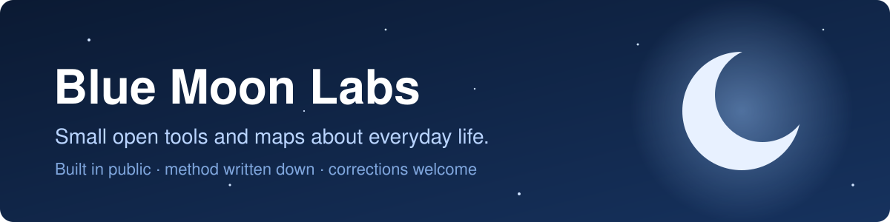

Hi, I'm Carl. I build small tools I'm curious about, show the method, and share what I learn,
mistakes included.

### 🗺️ First project: Everyday Exposure

**How many license plate reader cameras would you pass on an ordinary errand?**
Every street gets a score from open map data. You can search your own street and see the method
behind the number.

🚧 *Launching soon.* **Follow** or ⭐ star to catch it on day one.

### 🤝 House rules

- Open data, open code, method written down
- Estimates are labeled as estimates
- Spot a mistake? [Open an issue](https://github.com/BlueMoonLabs76/BlueMoonLabs76/issues). Corrections get credited.
